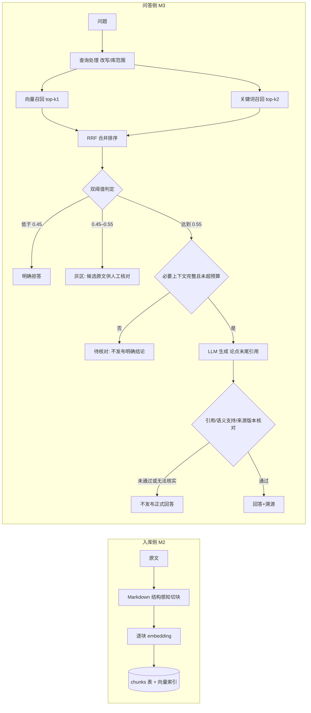

# 04-检索链路设计（v0.10）

| 字段 | 内容 |
|---|---|
| 状态 | 已实现（本层决策 DR1–DR6 已拍板） |
| 版本 | v0.10 |
| 日期 | 2026-10-18 |
| 上游 | `01-requirements.md`（PRD v0.5）· `02-modules.md`（v0.4）· `03-data-model.md`（v0.4，DDL 使用 `chunks.embedding vector(1024)`） |
| 变更 | v0.10：有界语句窗口、生成阶段保留追问指代、可配置语义支持核对 |
| 关联 | M2/M3 子 Issue（建仓后建立） |

> 本文回答检索链路四个问题：**怎么切、怎么向量化、怎么召回、怎么判定**。
> 本文不写：回答生成的 prompt 细节（M3 模块设计时填）、评估方法（`06-evaluation.md`）。

## 1. 链路全景

> 图注：链路分入库侧（一次性，M2）与问答侧（每次请求，M3）。问答侧四站——
> 查询处理 → 双通道召回 → 合并排序 → 阈值判定；生成后分别检查引用结构、语义支持和来源版本，这些检查不等于正确性证明。

## 2. 切分策略（入库侧）

**目标**：块是检索与溯源的原子单元——块太小丢上下文、太大稀释语义，切分错误无法靠检索补救。

**方法**：Markdown 结构感知切块（DR1）：

1. 按 Markdown 标题划分章节，再按段落、列表项和完整语句组块；标题能与后续单元一并容纳时不单独成块。TXT 使用相同的段落与句界规则。
2. `CHUNK_MAX_CHARS` 默认 800，是组块目标字符数，不是 token 数，也不是一句一个向量。短段落整体保留；长段落按完整句子组合，逗号、分号和软换行不作为句末，避免拆散否定和条件。
3. `CHUNK_OVERLAP_CHARS` 默认 80，是重叠预算：只重复预算内最后一个完整语句；与下一单元无法同时容纳时取消重叠，不从句子中间截取尾部。
4. 围栏代码、表格、独立公式与列表项整体保留；行内公式、代码、链接及图片语法受保护。图片包还传入上传解析得到的精确图片区间，图片字节不进入 embedding，alt 文本和周边正文照常参与检索。
5. `CHUNK_MAX_UNIT_CHARS` 默认 1600，必须不小于目标大小。完整语句或不可分割结构可以超过目标但不能超过该上限；超过时明确记录解析失败，不硬截原文。维护者可按语义补充段落或调整配置后重试，已有成功索引继续保留。
6. `chunk.text == source[char_start:char_end]`，返回区间覆盖非空原文全部字符且持续向前，不改写标点、换行、图片位置或原图字节。

**调参权**：切分参数是本项目最大的调参面，所有参数以 06 评估结果为准回调，不在文档里拍死。

切分修复不会自动更新已有块；旧文档需重新解析和生成向量，同内容重传可能因 hash 幂等而跳过，维护方法见 [运行与维护 §3](../operations.md#3-切块修复与已有知识库)。

### 2.1 生成前的必要上下文

完整句界不能保证代词、跨句条件或转折都能独立理解。L1 达到回答线后，从同一文档的已发布索引按字符区间还原原文，补齐命中块的首尾完整单元，并对规则识别的指代和转折补充同章节相邻块。不读取可能尚未发布的磁盘改稿，不跨章节猜测主语；补入块也检查自身边界。索引缺字、重叠文本冲突或前提无法确认时返回 `context_incomplete`，不发布明确结论。

`ANSWER_CONTEXT_NEIGHBOR_UNITS` 默认 1，允许 0–3，为每个原始检索命中增加前后完整语句/结构窗口，以覆盖没有固定句首标记的跨句语境。补充块只恢复显式依赖，不再次扩展普通窗口，避免递归带入全文。普通窗口材料不会自动成为正式引用或必需依赖；模型实际引用它，或规则确认存在完整句子、条件或指代依赖时，才作为本次正式证据保留。

原始命中的排序、向量分数和 L1 判断保持不变，补入块没有向量分数。生成时按原文顺序展示显式关联的来源，并保留各自真实 chunk id、原文和字符位置；正式引用携带必要上下文依赖，后续出处核对不得只保留结论片段。

`ANSWER_CONTEXT_NEIGHBOR_CHARS` 默认 1600，限制单处必要补充块的字符量；`ANSWER_CONTEXT_MAX_CHARS` 默认 12000，同时约束全部证据原文以及附有来源元数据的生成上下文。超限返回待核对，不静默截断。规则不增加模型调用，但会增加数据库读取和部分生成输入；它不能证明任意自然语言的语义完整性，大文档性能和新切分下的召回质量仍需独立评估。

## 3. Embedding 通道（入库侧）

| 约束 | 结论 |
|---|---|
| 中文为主的课程笔记 | 需中文能力强的 embedding 模型 |
| 无 lab 服务器（当前） | 云 API；接口按 OpenAI 兼容协议抽象，供应商可配（D2 的 provider 边界） |
| 当前 DDL 已落 `vector(1024)` | 默认模型固定 1024 维，换模型需迁移（写进 DR2 代价） |

- **当前默认**：SiliconFlow 的 OpenAI 兼容 embedding（`BAAI/bge-m3`，1024 维，中文能力强）。
- **供应商切换**：provider 接口保持 OpenAI 兼容；切换模型时必须同步配置并执行一次向量维度迁移。
- **请求边界**：入库按 `EMBEDDING_BATCH_SIZE` 分批；单批遇到限流、5xx 或传输故障时指数退避重试，已成功批次不重复请求。HTTP 200 仍需校验 JSON 结构、数量、index、数值有效性和向量维度。
- **实现边界**：embedding 调用归 M2（入库）与 M3（查询向量化共用同一 provider 服务），模型不一致会导致向量空间错位——**全项目 embedding 模型必须唯一**（写入 DR2 边界规则）。

## 4. 混合检索与合并（问答侧）

### 4.1 为什么需要关键词通道

向量检索擅长语义近似，但**精确词面**（术语缩写、函数名、编号、公式）召回弱：问"select 和 poll 的区别"，向量可能召回"epoll 原理"，词面通道能锁定字面命中。中文场景关键词通道的另一价值：罕见专名（人名/课程名缩写）的精确锚定。

### 4.2 双通道设计（DR3）

| 通道 | 承载 | 召回量 |
|---|---|---|
| 向量 | pgvector cosine（HNSW 索引），`kb_id` 过滤 | top-k1 = 20 |
| 关键词 | PostgreSQL `pg_trgm` 相似度（内置扩展，零部署），`kb_id` 过滤 | top-k2 = 10 |

- 关键词来源：实际检索问题（追问时为改写后的问题），当前没有单独的 LLM 关键词抽取调用。
- 关键词 SQL 使用 `content % :query` 预过滤，再按 `similarity(content, :query)` 排序；以事务局部配置设置相似度阈值（默认 0.1）。`%` 可使用 `gin_trgm_ops`，具体计划仍取决于数据量与选择性，见 [PostgreSQL pg_trgm 索引支持](https://www.postgresql.org/docs/16/pgtrgm.html#PGTRGM-INDEX)。
- **合并：RRF（Reciprocal Rank Fusion）**——按排名倒数的倒数求和，不依赖两个通道的分数尺度可比性（向量余弦与 trigram 相似度量纲不同，加权求和需标定权重，RRF 免标定，是业界通用 baseline）。

### 4.3 中文分词的取舍（DR4）

PostgreSQL 原生 FTS（tsvector）对无空格中文无效，需 `zhparser`/`pg_jieba` 等扩展（涉及镜像编译/维护）。MVP 决策：

- 关键词通道用 `pg_trgm`（随 PG 自带，`CREATE EXTENSION` 即用）。
- 已知局限：trigram 对 2 字词匹配弱——由向量通道互补；若 06 评估显示关键词通道贡献低于预期，**降级为纯向量 + 简单词面过滤**，不引入外部引擎。
- 升级条件（记录在案）：评估显示词面召回是主要漏检源时，评估引入 `zhparser`（docker 镜像方案）的收益再动。

## 5. 溯源与防幻觉（问答侧）

回答必须可溯源是产品第一原则（01 §1.2）。引用结构与语义支持分别检查：

1. **生成约束**：prompt 三重声明——① 只基于提供的块作答，未提供的知识一律不答；
   ② 引用标注 `[n]` 对应块序号；③ **先给结论、再用资料里的机制/步骤/条件展开解释**，
   资料写到几个要点就展开几点。
   > 第 ③ 条是 2026-09-10 修订：只要求引用、不要求解释时，模型会给出「一句话结论 + 一串引用」
   > （实测："TCP 三次握手是为了确认双方的发送与接收能力都正常 [1][2][3][4]"），
   > 用户读不到逻辑依据。要求展开后，同一问题会给出"第一/二次握手确认什么 → 为何不够 →
   > 第三次解决什么"的分层解释，且引用仍逐句可核对。
2. **引用校验（生成后强制检查）**：解析回答中的每个 `[n]`，要求编号属于本次提供的块，且至少存在一个有效引用；越界或零引用不发布整答。此检查是纯规则，不判断论点是否被原文支持。
3. **溯源呈现**：回答携带 citation 列表（块 id → 03 的 `char_start/end`），前端据此跳转高亮。

### 5.1 语义支持核对

`app/evidence/support.py` 在规则校验之后核对完整草稿，默认启用 `ANSWER_SUPPORT_CHECK_ENABLED`，复用现有 LLM 服务、模型和超时配置，增加一次非流式调用。每个非空输出行都有确定的单元编号，包括未标注引用的句子；核对模型必须判断该单元内所有事实，特别是对象、否定、条件、范围和因果方向。返回值只有 `supported`、`unsupported`、`contradicted`，不能遗漏或重复单元。

支持判断须附属于所选来源的连续摘录，编号必须属于该单元声明的引用及其必要上下文；未标注引用的单元只能使用本次正式来源。摘录按 Unicode 表示与空白归一后检查原文包含关系，不能编造或从无关来源借用。纯分隔符可以没有摘录，非空标题不能依靠“无事实”自述绕过摘录检查。覆盖与摘录检查是规则，语义判断仍由模型完成，两者不能互相替代。

矛盾或缺乏支持返回 `answer_not_supported`；核对响应损坏或模型不可用返回 `support_verification_failed`；完整核对输入超过 `ANSWER_SUPPORT_MAX_CHARS`（默认 32000 字符）返回 `support_context_limit`。这些结果均为 `unverified`，不携带正式引用、不写入事实性追问历史；矛盾/缺证据时可展示候选原文供人工核对。预算超限不截断后放行。核对之后再次验证已发布来源，防止模型等待期间原文更新。

同步、SSE 和工作流知识步骤共用核对；仅输出文档名与区间的规则式出处整理不再追加语义调用。关闭配置时不再检查语义支持，但引用结构与来源版本检查仍执行。模型核对会增加延迟和费用，也可能与生成模型犯相同错误；隔离反例测试验证的是拒答与发布行为，不代表真实模型准确率或消除了幻觉。

## 6. 拒答判定（问答侧）

两级判定，与 01 §4.2 流程一致：

| 级 | 时机 | 机制 | 参数 |
|---|---|---|---|
| L1 | 召回合并后 | 最高**向量相似度**低于拒答线 → 明确拒答；位于两线之间 → 灰区；达到回答线 → 检查必要上下文后才允许生成 | **拒答线 0.45 / 回答线 0.55**（06 的 v2 多库评估校准） |
| L2 | 生成后 | 引用越界、零引用、上下文依赖、可配置语义核对及来源有效性检查；模型自述资料不足单独返回 `generation_insufficient` | 语义核对默认启用，输入上限 32000 字符 |

**设计要点**：检索分数分布随库内容漂移，绝对阈值只能作为护栏。单阈值 0.50 会把
0.493 与 0.543 两侧的边界样本直接分成“完全无关”和“可以作答”，无法表达证据不确定性。
双阈值把不确定性显式交给用户核对，同时仍禁止模型根据灰区材料生成看似确定的回答。

**校准结果（06 §6，2026-10-08 v2 实测）**：5 个库、60 条样本中，库内问题最高
相似度范围约为 0.543–0.808，库外约为 0.332–0.493。使用 **0.45 / 0.55** 后，
10 条库外问题中 0 条自动回答、4 条进入灰区、6 条明确拒答；50 条库内问题中 49 条
自动回答、1 条进入灰区、0 条明确拒答。该阈值对只适用于当前模型与检索实现，换模型、
语料分布或相似度实现后必须重新扫描。

灰区结果的 `status=needs_review`、`refused=true`、`refusal_reason=borderline_relevance`。
它最多携带前三条 `possible_sources`，正式 `citations` 始终为空；候选存在但没有有效向量
分数时也进入灰区，不能借关键词命中绕过回答线。空候选仍是 `empty_kb` 明确拒答。

**L1 与 L2 的分工**：L1 是便宜的前置护栏，L2 是生成后的兜底——两者都要有，
但**能用 L1 拦下的不应留给 L2**。L2 的引用规则与来源版本检查是确定性的；语义支持核对仍依赖模型判断，不能保证逻辑蕴含关系。

生成输入包含后端提供的文档名称、字符位置和编号原文，同步与流式使用同一构造器。`low_relevance` 只表示检索未达门槛；`generation_insufficient` 表示模型认为所给原文不支持问题。空候选代码仍为 `empty_kb`，文案只说明本次检索未取得原文，不推断整个知识库为空。

M3 提供 `answer_from_sources`，接收同一次工作流的正式来源快照，核对已发布内容和库范围，再整理全部出处或按主题选择出处。它不执行新的知识检索，不产生或继承向量分数，选择编号仍需合法性与 L2 校验；来源上下文、预算和依赖规则见 [05 §3.6](05-agent-workflow.md#36-出处核对的边界与预算)。

`context_incomplete` 也使用 `status=needs_review`，但不表示相似度落在灰区；即使分数很高，缺少必要上下文也不允许发布结论。同步、流式和工作流知识步骤共用该检查。回答发布前再次核对已使用片段、原文区间、库范围和已发布内容摘要；来源变化返回 `source_changed`，核对故障返回 `source_validation_failed`，均不写入事实性追问历史。

### 6.1 流式传输与最终发布

界面使用 `POST /api/v1/ask/stream`，因为问题、库范围和历史都在请求体中；服务端响应为
`text/event-stream`，事件顺序固定为：

1. `metadata`：数据库阶段已结束，返回实际检索语句；此时检索候选和引用已经复制为普通数据，事务已回滚。
2. `delta`：供应商产生的文本增量。它是**待 L2 校验草稿**，前端明确标注状态，引用编号暂不绑定原文。
3. `result`：完整文本经过引用规则、已启用的语义核对和来源版本检查后形成的最终 `AnswerOut`；只有 `answered` 结果会作为事实性回答进入浏览器追问历史。灰区和核对失败结果仍保存在本地会话供查看，但不会参与下一次查询改写；已显示草稿由最终结果替换。

L1 在任何模型正文发送前完成；空库、低相关、灰区、Embedding 不可用或模型指纹不一致只产生
`metadata + result`，不会产生 `delta`。供应商在流中失败时，已显示草稿由最终
`llm_unavailable` 拒答替换。未处理异常则发送不含内部细节、带 request ID 的 `error` 事件，
且不写会话。兼容脚本仍可使用同步 `/api/v1/ask`，两条路径共用同一个准备与 L2 校验实现。

## 7. 会话追问与查询改写（问答侧）

D5 已拍板会话入 MVP。追问（"那拥塞窗口怎么调？"）是**指代句**，直接拿去检索会错过上文主题词：

- **DR5 决策**：追问进入检索前，先由 LLM 改写为**自包含问题**（"TCP 拥塞窗口怎么调整？"）再走双通道检索；改写调用与回答同会话上文，成本 = 每次追问 1 次轻量调用。
- 边界：改写失败（LLM 不可用）时退化——用本次原问题检索，保证链路可用性不因增强件而断。
- 生成时同时传入原始问题与解析指代后的完整问题；完整问题用于理解对象，不作为事实证据，原始问题的格式、范围和输出要求继续保留。同步和 SSE 使用同一提示词构造器。

### 7.1 上下文来源：前端持久化 + 请求携带（2026-09-10 修订）

会话上下文有两条来源，**请求体携带的 `history` 优先**：

| 来源 | 机制 | 存活范围 |
|---|---|---|
| `history`（首选） | 前端把会话存在浏览器本地（localStorage），每次追问把最近 6 轮随请求回传 | 跨刷新、跨服务重启（存在用户设备上） |
| `session_id`（兼容） | 服务端进程内会话（D5 原方案，TTL 30 分钟） | 进程生命周期 |

**为什么改成请求携带**：D5 定的"进程内存、不落库"在体验上有硬伤——刷新页面即丢上下文，
用户会看到"追问改写在刷新后失效"。改为前端持有后：

- 当前界面的追问上下文不依赖服务端会话存活（兼容 `session_id` 路径仍有进程状态，不引入会话表）；
- 上下文随用户设备走，刷新/重启都不丢；
- 代价：每轮多传最多 6 轮对话（约数百 token），且**历史由客户端提供**——
  因此历史只用于问题改写，改写结果供检索和生成理解指代，不把历史回答当作本轮原文证据。

**保存与停止（前端交互，M5）**：会话列表存 localStorage（新建/切换/删除）；
请求进行中可点「停止」中断等待（AbortController），被停止的问题不入会话记录。
停止不会取消服务端同步模型调用；30 分钟兼容会话 TTL、单 worker 与后台任务边界见 [运行与维护 §1](../operations.md#1-当前运行边界)。

## 8. 决策记录（2026-09-06 拍板）

| 编号 | 决策（已拍板） | 备选与代价 | 理由 |
|---|---|---|---|
| DR1 | Markdown 结构感知完整语句组块，目标 800 字符、整句重叠预算 80、不可分割单元上限 1600 | 定长窗口可能拆散否定和条件；一句一块增加索引量且丢失跨句上下文 | 保留原文锚点，超限明确失败；检索后补充必要前提，不将句界等同于语义证明 |
| DR2 | Embedding：OpenAI 兼容协议、供应商可配；当前默认 BAAI/bge-m3（1024 维）；**全项目模型唯一** | 锁死供应商：迁移成本更高；多模型混用=向量空间错位 | 默认配置、数据库列与现有知识库统一，切换模型需显式迁移 |
| DR3 | 检索合并：向量 top-20 + 关键词 top-10 双通道，RRF 合并 | 加权分数和：量纲不同需标定权重 | RRF 按排名倒数求和，免标定，业界通用 baseline |
| DR4 | 关键词承载：`pg_trgm`（内置扩展） | `zhparser`/`pg_jieba`：中文 FTS 强但引入镜像维护 | 零部署成本先验证链路；trigram 局限由向量通道互补；收益不足则降级纯向量+词面过滤（升级条件记录在案） |
| DR5 | 追问查询改写：LLM 轻量改写为自包含问题再检索 | 不改写：指代句检索命中差 | 改写是 D5 会话的配套件；失败退化本次原问题检索保可用 |
| DR6 | L1 双阈值证据门（拒答 / 灰区 / 可回答）+ L2 引用、可配置语义及来源版本核对 | 单阈值无法表达边界不确定性；合法引用也不等于支持回答内容 | 灰区不调用回答模型，只展示候选快照；两条阈值由 06 成对扫描，语义调用成本单独控制 |

## 9. 移交清单

| 移交对象 | 内容 |
|---|---|
| 03（已完成） | 初始迁移创建 `vector(1536)`，后续迁移已统一为 BAAI/bge-m3 的 `vector(1024)` + HNSW 索引（cosine） |
| 06（评估） | 拒答线/回答线成对扫描；切分参数（块大小/重叠）网格；混合 vs 纯向量对比基线 |
| M2/M3 模板 | 切分器与 provider 的接口契约；引用校验规则（§5）转测试用例 |

## 10. 下一步衔接

- 本层决策已全部拍板（DR1–DR6）；随后建仓（README + docs + 总功能 Issue）。
- 04 定稿不阻塞 M1（库/文档 CRUD 不依赖检索细节）；建仓后可立即启动 M1 骨架。
