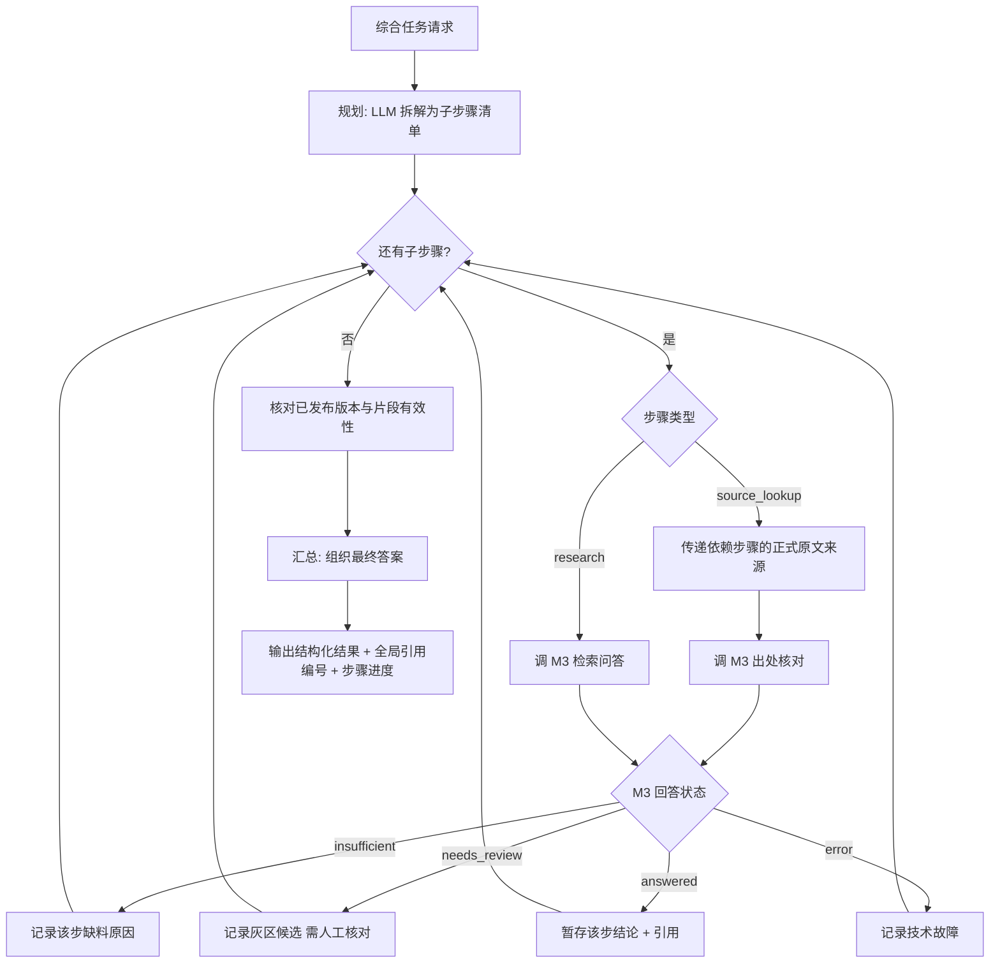

# 05-Agent 多步工作流设计（v0.5）

| 字段 | 内容 |
|---|---|
| 状态 | 已确认（本层决策 AW1–AW6） |
| 版本 | v0.5 |
| 日期 | 2026-10-12 |
| 上游 | `01-requirements.md`（PRD v0.4 §4.3 流程图）· `02-modules.md`（M4 边界）· `04-retrieval.md`（检索链路，被复用） |
| 变更 | v0.5：出处复用保留必要上下文依赖，并区分上下文不完整与低相关性 |

> 本文回答：跨文档综合任务如何拆步、执行、记录缺料、汇总——以及 M4 与 M3 的边界在哪。

## 1. 范围与边界（红线）

M4 是**编排者**，不是第二个 RAG：

| 属于 M4 | 不属于（复用 M3） |
|---|---|
| 任务目标拆解（规划步骤清单） | 单步检索与生成（M3 的 retrieve + generate） |
| 子步骤循环调度与顺序控制 | 切分与向量化（M2） |
| 每步缺料判定与记录 | 库/文档 CRUD（M1） |
| 跨步汇总与最终结构化输出 | 拒答判定规则（M3 的 L1/L2） |
| 执行进度对用户可见 | —— |

**红线理由**（02 §3）：若 M4 自己实现检索，会出现两套检索逻辑（参数、拒答阈值分裂），检索质量再也无法统一评估。

## 2. 工作流全景

> 图注：规划 → 按步骤类型调用 M3 → 核对引用来源 → 汇总；
> 每步都产出「有料结论 + 引用」或「缺料记录」，最终答案是这些步骤的组合。



## 3. 各阶段设计

### 3.1 规划（Planning）

- **输入**：用户任务（如"总结我在 TCP 上记过哪些知识点，逐条给出出处"）+ 可选库范围。
- **输出**：JSON 步骤清单，包含 `goal`、`query`、`kind`、`depends_on`；出处步骤可指定 `source_scope`。
- **做法**：LLM 生成，要求输出 JSON 数组（失败则退化为「单步 = 原任务」，不阻断用户）。
- **约束**：知识步骤必须自包含，`depends_on` 为空；出处步骤的依赖只能指向前序步骤，默认按主题核对，`source_scope=all` 仅表示列出指定步骤全部引用。非法类型、前向依赖、重复依赖或无依赖的出处步骤使规划退化为原任务。
- **回答要求**：“给出处、附引用”保留在相应知识问题中，通常不拆步；“比较数列极限和函数极限，并给出处”可作为单步。穷举新知识或追溯原始作者仍执行知识检索。

### 3.2 执行（Execution）

- `research` 调用 `ask.answer_question`；`source_lookup` 调用 `ask.answer_from_sources`，使用依赖步骤已正式引用的原文。生成和来源选择均由 M3 实现。
- **每步结果四态**：
  - `answered`：M3 正常回答 → 暂存结论 + 引用
  - `needs_review`：M3 命中双阈值灰区，或必要上下文无法补齐 → 保留候选原文供核对，不发布结论、不计入正式引用；通过 `refusal_reason` 区分原因
  - `insufficient`：检索不足、生成证据不足、前序来源不可用或原文未覆盖本项内容；分别保存 `refusal_reason`，不能统一解释为库中没有内容
  - `error`：LLM 不可用等技术故障 → 记录错误，**继续后续步骤**（不因单步故障整体失败）
- **顺序执行**：依赖只向前。前序步骤灰区时，出处步骤保留待核对状态及候选；前序拒答/故障时说明依赖不可用，无关知识步骤继续执行。
- **事务恢复**：单步异常后执行数据库回滚，再继续下一步；只记录异常而不恢复事务不能兑现单步隔离。改写、Embedding、回答生成期间不持有已完成的只读事务，见 [运行与维护 §2](../operations.md#2-事务与连接池)。

### 3.3 缺料记录（关键差异点）

这是 M4 与"一次生成"的本质区别：**每步都能说清"哪一步没查到"**，而不是笼统地答不好。

```text
第 2 步「拥塞控制的具体算法」：本次检索相关性不足（最高相似度 0.21 < 拒答线 0.45）
第 3 步「拥塞窗口边界」：找到可能相关原文（最高相似度 0.51 < 回答线 0.55），需人工核对
```

### 3.4 汇总（Synthesis）

- 输入：各步骤的结论 + 引用 + 灰区/缺料/故障记录。
- 输出：结构化结果（分步列出结论），**引用编号全局统一**（跨步连续编号，前端可逐条溯源）。
- 当前汇总按规则拼接步骤结果，重映射已由 M3 校验的引用编号；汇总阶段不再调用 LLM。未来如引入模型汇总，仍须重新校验引用。
- 灰区和缺料步骤在最终结果中分别标注；灰区候选不会进入全局引用重编号（US-M4-02）。
- 同一片段跨步骤复用一个编号，同文档不同片段分别保留；来源元数据由后端填入，前端按文档分组展示。
- 返回前批量核对已使用片段、库范围和已发布 `content_hash`。失效结论及依赖结论不发布，提示重新执行；数据库核对故障单独说明。文档处于更新中但旧片段与已发布摘要未变时仍可引用。

### 3.5 进度可见（US-M4-01）

- MVP：同步执行，接口**一次返回完整步骤清单 + 每步状态 + 最终答案**（前端可展示"执行了哪几步、每步结果"）。
- 等待期间点「停止」只断开客户端等待，服务端继续执行；调用次数与单进程边界见 [运行与维护 §1](../operations.md#1-当前运行边界)。
- 演进（V1.0）：异步执行 + 轮询/SSE 推送步骤进度（与 M2 的任务状态机同款思路）。

### 3.6 出处核对的边界与预算

本次工作流的来源上下文不跨请求共享，只收集前序成功回答实际引用的快照及其必要上下文依赖。`all` 直接整理去重后的引用元数据；`topic` 最多一次模型原文核对，输出编号、问题中的目标对象名与连续原文摘录。M3 校验对象名存在于问题及片段或明确关联的上下文中；摘录必须来自选中片段自身，且至少含 8 个非空白字符（只忽略 Unicode 表示与空白差异）。对象名不能借用无关联的其他片段，输出保留必要上下文，再组装出处并执行 L2。

核对指令与知识回答指令分离，限定为前序所用定义/条件/依据的出处，不以原文是否写出“判别方法”字样判断，也不扩展为全部方法。两种出处模式都不调用 Embedding、向量或关键词检索，`search_query` 与 `evidence` 为 `null`，不继承父步骤相似度。知识步骤的上下文补全和预算见 [04 §2.1](04-retrieval.md#21-生成前的必要上下文)，与出处核对预算分别配置。

`WORKFLOW_SOURCE_MAX_CHARS` 默认 32000，限制主题核对输入的原文和文档名称字符量；超限明确提示拆分，不静默截断。编号与摘录校验保证来源及字面对应关系，不保证语义必然正确；同义表达未能找到字面对应时会保守报核对未通过，评估仍需核对问题与原文的对应关系。

## 4. 数据原型与接口

```python
class WorkflowStep:
    index: int
    goal: str                 # 该步要查什么
    query: str                # 规划产生的子问题
    status: str               # answered / needs_review / insufficient / error
    conclusion: str | None    # 该步结论（answered 时）
    note: str | None          # 灰区/缺料/错误说明
    citations: list[Citation]
    possible_sources: list[EvidenceCandidate]  # 仅 needs_review，非正式引用
    kind: str                # research / source_lookup
    depends_on: list[int]    # 只指向前序步骤
    source_scope: str        # topic / all
    search_query: str | None # 本步实际检索语句；出处步骤无检索
    evidence: RetrievalEvidence | None
    refusal_reason: str | None
    evidence_origin: str | None # retrieval / previous_step

class WorkflowResult:
    task: str
    steps: list[WorkflowStep]
    answer: str               # 汇总后的最终答案
    citations: list[Citation] # 全局统一编号的引用
```

```text
POST /api/v1/workflow
  请求体: {"task": str, "kb_id": int | "all"?, "max_steps"?: int}
  200: WorkflowResult          # 含每步状态与缺料说明
  400: 空任务 / 知识库为空
  404: kb_id 指定的库不存在
  422: 参数校验失败
```

## 5. 决策记录（AW1–AW5：2026-09-10；AW6：2026-10-10）

| 编号 | 决策（已拍板） | 备选与代价 | 理由 |
|---|---|---|---|
| AW1 | 规划由 **LLM 生成 JSON 步骤清单**，解析失败退化为「单步 = 原任务」 | 固定模板：可控但只能处理预设任务类型 | 综合任务形态不可穷举；退化路径保证规划失败不阻断用户 |
| AW2 | 步骤上限 **默认 5 步**（配置 `workflow_max_steps`）；请求只能降低上限，实际取配置与请求的较小值 | 不限：LLM 可能拆出十几步，成本与耗时不可控 | 上限保证单次任务可预期；复杂任务由用户分次发起 |
| AW3 | **MVP 同步执行**：一次请求返回全部步骤与最终结果（含每步状态） | 异步 + 轮询/SSE：体验更好但需任务状态机 | 同步实现简单、可测；步骤进度仍在响应结构里对用户可见（US-M4-01）。异步留 V1.0 |
| AW4 | **引用全局统一编号**（跨步连续），汇总时复用 M3 的越界校验 | 每步独立编号：前端需处理多套编号，溯源易混 | 前端只需一套"点 [n] 跳原文"逻辑；防幻觉校验自然复用 |
| AW5 | **显式端点** `POST /api/v1/workflow`，M3 只做单轮问答 | 在 /ask 内部自动识别多步任务 | 职责清晰、行为可预期；自动识别会让 /ask 的响应结构随任务类型漂移 |
| AW6 | 出处属于回答要求；独立出处步骤复用依赖原文，由 M3 核对与组装 | 每项出处重新向量检索会引入措辞敏感和重复成本；全步骤共享所有材料会混淆证据范围 | 以原文和依赖关系整理出处，同时保留新知识检索的 L1 门槛 |

## 6. 与评估（06）的关系

- M4 的评估不属于检索质量评估（那是 06 的主体），但可用同一套评估集构造**多步任务**：
  期望"任务 X 应命中文档 A 与 B，且不遗漏 C 主题"。
- 指标：步骤规划合理性（人工抽查）、每步引用正确率、缺料识别准确率。
- 受控回归覆盖独立出处、灰区/失败依赖、来源替换/删除/越库、上下文预算、同步/流式原因与历史对话。原例三步仅执行一次查询向量化和检索；全部出处整理不调用生成模型，主题出处整理最多一次核对调用。日志记录步骤类型、拒答原因、复用数量与阶段耗时，不记录原文或密钥。

## 7. 下一步

- 用真实知识库持续抽查规划合理性和出处对应关系；受控测试通过不代表模型语义选择必然正确。
- 异步进度、跨请求来源持久化与额外语义审核不属于本次修复，后续按实际需求评估。
